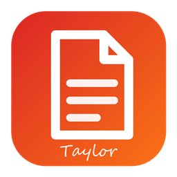
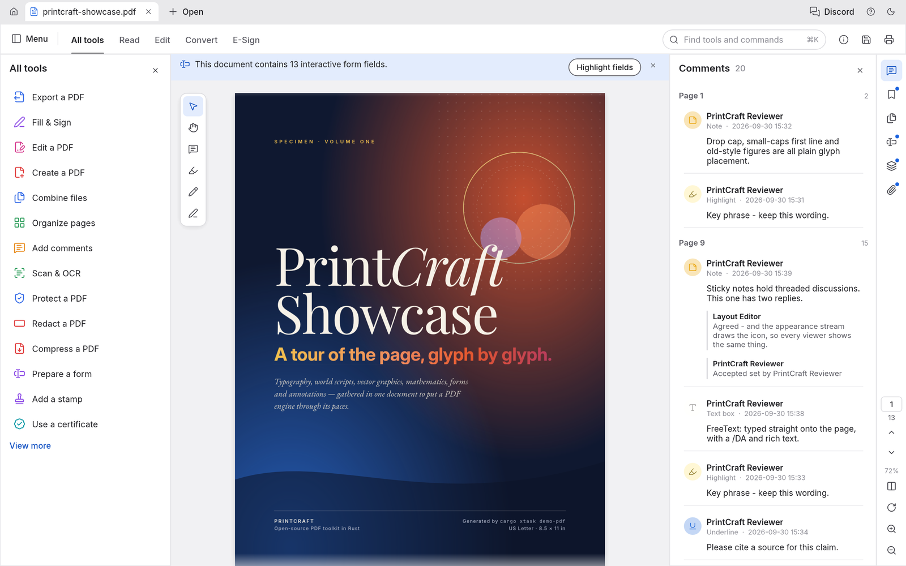

  

<h1 align="center">LocalPDF</h1>

  <b>The PDF workbench; an open-source, modern PDF reader and editor, built in pure Rust.</b> 
  Read, organize, combine, split and secure PDFs in a fast, native app, written in Rust from the ground up.

  
  
  
   

  <a href="https://github.com/Anon5T4R/local-pdf"><b>LocalPDF on GitHub</b></a> ·
  <a href="https://github.com/Anon5T4R/">Local</a> ·
  <a href="https://github.com/Anon5T4R">Anon5T4R</a>

 

  
   

  <a href="#highlights">Highlights</a> ·
  <a href="#read-anything-beautifully">Read</a> ·
  <a href="#find-it-select-it-copy-it">Find</a> ·
  <a href="#organize-pages-like-cards-on-a-table">Organize</a> ·
  <a href="#combine-and-split-without-losing-a-thing">Combine &amp; split</a> ·
  <a href="#open-protected-documents-and-respect-their-rules">Protect</a> ·
  <a href="#comments-forms-layers-and-attachments">Forms &amp; layers</a> ·
  <a href="#runs-everywhere-stays-yours">Everywhere</a> ·
  <a href="#built-for-agents-too">Agents</a> ·
  <a href="#how-its-built">How it's built</a> ·
  <a href="#get-started">Get started</a> ·
  <a href="#whats-next">What's next</a> ·
  <a href="#downloads">Downloads</a> ·
  <a href="#the-crafting-apps">Crafting Apps</a>

---

## License and credits

LocalPDF is dual-licensed under [MIT](LICENSE-MIT) or [Apache-2.0](LICENSE-APACHE), at your option.
Copyright (c) 2026 Local Team and the LocalPDF contributors. Required notices are in [NOTICE](NOTICE).

Bundled fonts, icons, images and other assets keep their own open licenses; each one is listed
with its author, source and license in [ATTRIBUTION.md](ATTRIBUTION.md). Release builds also embed
the Japanese fonts of [craft-fonts](https://github.com/storytold/craft-fonts/blob/main/ATTRIBUTION.md)
(SIL Open Font License 1.1).

Fork independente, mantido por Anon5T4R na suíte Local. Créditos de código originais em [ATTRIBUTION.md](ATTRIBUTION.md).

  Suíte Local — apps locais, sem conta, sem telemetria.

The Tools panel sits on the left, or on the right with Preferences ▸ Tools panel side. The rail stays at the right edge and opens one side panel beside it. Drag a panel's inner edge to resize it; widths are remembered. F4 shows or hides the side panel and Shift+F4 the Tools panel (also in the View menu); View ▸ Reset side panels restores the default arrangement.
