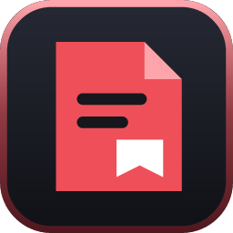

<p align="center">
  
</p>

<h1 align="center">Local PDF</h1>

<p align="center">
  <b>Read, edit, fill, sign and organize PDFs in a fast native app.</b><br>
  No account, no telemetry, no cloud. Written in Rust from the file parser up.
</p>

<p align="center">
  <a href="https://github.com/Anon5T4R/local-pdf/releases/latest"><b>Download</b></a> ·
  <a href="#what-it-does">Features</a> ·
  <a href="#privacy-and-security">Privacy and security</a> ·
  <a href="#why-pure-rust">Why pure Rust</a> ·
  <a href="#build-from-source">Build</a>
</p>

<p align="center">
  
  
  
  
</p>

<!-- README-SHOT: hero — a real multi-page document open, comments panel visible; dark and light -->
<p align="center">
  <picture>
    <source media="(prefers-color-scheme: dark)" srcset="docs/images/readme/hero-dark.png">
    
  </picture>
</p>

## What it does

- **Read and navigate.** Opens PDFs, including password-protected ones. Single page, continuous and
  two-page layouts, find and advanced search, and side panels for comments, bookmarks, pages, forms,
  layers, attachments, signatures and the tag tree.
- **Edit what is already there.** Change existing text and images on the page, move or duplicate
  several objects at once, add stamps, watermarks, headers and footers, and backgrounds.
- **Organize.** Insert, extract, split, combine, rotate and reorder pages; manage bookmarks.
- **Forms.** Fill and flatten AcroForms, import and export XFDF, and open static and dynamic XFA
  forms. Form scripts run in a sandboxed JavaScript engine.
- **Sign and protect.** Digital signatures with your certificate, password protection and
  permissions, and true redaction (the content is removed, not covered).
- **Convert and repair.** OCR for scanned pages, export pages as images or text, PDF/A, compression,
  and accessibility and prepress audits. Compare two versions of a file.
- **Print** straight from the app.
- **Automate.** `localpdf-cli` runs the same tools from the command line or as an MCP server for AI
  agents, and can drive the open app ([docs/mcp.md](docs/mcp.md), [docs/cli-batch.md](docs/cli-batch.md)).

<!-- README-SHOT: two small shots side by side — page organizer, and form filling -->
<p align="center">
  
  
</p>

## Download

Get the latest version from [Releases](https://github.com/Anon5T4R/local-pdf/releases/latest).

| System | File |
|---|---|
| Windows 10/11 (x64) | `localpdf-<version>-windows-x64.msi` (installer) or `-portable.zip` |
| Linux (x86_64) | `.AppImage`, `.deb`, `.rpm`, Arch `.pkg.tar.zst` or `.tar.gz` |

When it starts, the app asks GitHub whether there is a newer version and offers it; nothing is
downloaded or installed without your OK.

Every file is signed with [minisign](https://jedisct1.github.io/minisign/). To check a download by hand:

```sh
minisign -Vm localpdf-<version>-windows-x64.msi -P RWTqN+hTTCFbDCGCA1cEJRLp2FSluxIUiJfqdoAYwkwNNVH5MTYH8qSN
```

The same public key is in [packaging/minisign.pub](packaging/minisign.pub), and `SHA256SUMS.txt` comes
with each release.

## Privacy and security

**What leaves your computer.** Your documents never do. The app makes exactly two kinds of network
request, both to GitHub: the update check when it starts, and the download when you accept an update. AI features
are off until you add your own provider and key (any OpenAI-compatible service, or a local server
such as llama.cpp or Ollama); then the text you send goes only to the service you chose.
No account, no analytics, no crash reporting.

**Why opening a hostile PDF is safer here.**

- The whole PDF pipeline is memory-safe Rust: parser, decryption, content streams, fonts, rendering,
  forms, JavaScript and OCR. There is no C or C++ PDF engine (no PDFium, MuPDF or Poppler), which is
  where most PDF reader vulnerabilities live.
- The app's own code has **no `unsafe` blocks**: none of its 34 crates or two binaries. `unsafe` only
  exists further down, in the window and GPU layers every desktop app needs (winit, wgpu).
- Damaged files are repaired from what is actually in them: a broken cross-reference table is rebuilt
  instead of trusted.
- Form JavaScript runs in a sandbox with no file or network access.
- Encrypted documents stay encrypted in autosave and crash recovery, and signed documents are
  protected from rewrites that would break the signature.

**How releases are made.**

- Built only by GitHub Actions from a tagged commit, for Windows and Linux, with `--locked`
  dependencies.
- Every dependency is checked by `cargo-deny` (known vulnerabilities, licenses, banned crates), and
  none comes from a git URL. Third-party code we patch is vendored in the repository, with its origin
  recorded.
- TLS for the update check is pure Rust too (rustls with RustCrypto): the program you install contains
  no `ring`, `aws-lc` or OpenSSL.

## Why pure Rust

Local PDF started as a fork of an open-source Rust PDF editor. We kept its engine and went further:
everything the app runs is Rust, so one toolchain builds it, one memory-safety story covers it, and
there is no native library to download at build or run time.

What we removed or replaced along the way:

- the web build (WebAssembly) and everything that only existed for it;
- C-based TLS and crypto providers (`ring`, `aws-lc`), replaced by pure-Rust ones;
- the upstream's branding and links: this fork talks to nothing but its own GitHub releases.

What it costs: some rare PDF constructs still render differently from Acrobat, and we fix them in our
own parser instead of borrowing a C engine. The [roadmap](ROADMAP.md) lists what is still missing.

## How it is built

One Cargo workspace: 34 library crates in layers, the desktop app, and the `localpdf-cli` tool.

| Layer | Crates | Role |
|---|---|---|
| Foundation | `geom`, `filters`, `crypt` | geometry, stream filters, the PDF security handler |
| Objects | `cos` | tolerant parser with repair, copy-on-write object graph, incremental writer |
| Document | `content`, `model`, `fonts` | content streams, page tree, font metrics |
| Services | `render`, `annot`, `forms`, `js`, `xfa` | rendering, annotations, forms, sandboxed scripts |
| Tools | `edit`, `organize`, `redact`, `sign`, `ocr`, `export`, … | one crate per tool family |
| Façade | `engine` | open documents, edit history, the command registry |
| Front ends | `ui-egui`, `automation`, `platform` | the desktop UI, the CLI/MCP tools, OS services |

Lower layers never depend on higher ones or on the UI, and `cargo xtask layers` enforces it. Edits
work on a copy-on-write clone of the document, every change becomes one incremental revision, and what
you see on screen is rendered from the same bytes that Save writes.
More in [docs/architecture.md](docs/architecture.md).

## Keyboard shortcuts

| Action | Shortcut |
|---|---|
| Find any tool or command | `Ctrl+K` |
| Open / Save / Save as | `Ctrl+O` / `Ctrl+S` / `Ctrl+Shift+S` |
| Find / Advanced search | `Ctrl+F` / `Ctrl+Shift+F` |
| Go to page | `Ctrl+Shift+N` |
| Actual size / Fit width / Whole page | `Ctrl+1` / `Ctrl+2` / `Ctrl+0` |
| Full screen | `Ctrl+L` |
| Print | `Ctrl+P` |
| Undo / Redo | `Ctrl+Z` / `Ctrl+Shift+Z` |

Every command and its shortcut is listed in the `Ctrl+K` palette.

## Build from source

You need Rust 1.95 or newer.

```sh
git clone https://github.com/Anon5T4R/local-pdf
cd local-pdf
cargo run --release -p localpdf     # the app
cargo xtask models                  # optional: the OCR models
cargo xtask ci                      # the full local check: format, lints, tests, layers, licenses
```

Low on disk? See [docs/development.md](docs/development.md) for the `low-disk` profile.

## Part of the Local suite

Local PDF is one of a family of desktop apps with the same promise: your files stay on your
computer, and the app works without an account.
[Local Word](https://github.com/Anon5T4R/local-office) ·
[Local Sheets](https://github.com/Anon5T4R/local-sheets) ·
[Local Slides](https://github.com/Anon5T4R/local-slides) ·
[Local PDF](https://github.com/Anon5T4R/local-pdf) ·
[Local Keys](https://github.com/Anon5T4R/Local-Keys) ·
[Local Image](https://github.com/Anon5T4R/Local-Image) ·
[Local Photo](https://github.com/Anon5T4R/Local-Photo) ·
[Local Paint](https://github.com/Anon5T4R/Local-Paint) ·
[Local Vector](https://github.com/Anon5T4R/Local-Vector) ·
[Local Player](https://github.com/Anon5T4R/Local-Player) ·
[Local Obsidian](https://github.com/Anon5T4R/Local-Obsidian) ·
[Local Mind](https://github.com/Anon5T4R/Local-Mind) ·
[Local Utils](https://github.com/Anon5T4R/Local-Utils)

## License and credits

Dual-licensed under [MIT](LICENSE-MIT) or [Apache-2.0](LICENSE-APACHE), at your option. Required
notices are in [NOTICE](NOTICE).

Local PDF is an independent fork of [pdfcraft](https://github.com/storytold/pdfcraft); the original
authors' credits are kept in [ATTRIBUTION.md](ATTRIBUTION.md), together with every bundled font, icon,
model and image and its license. Release builds embed the Japanese fonts of
[craft-fonts](https://github.com/storytold/craft-fonts/blob/main/ATTRIBUTION.md) (SIL Open Font
License 1.1).
